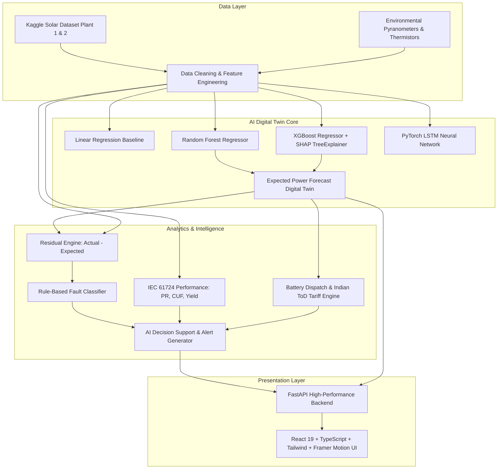

# Intelligent Solar Energy Management System (AI Digital Twin)

An end-to-end industrial-grade AI platform for utility-scale solar photovoltaic (PV) power forecasting, performance monitoring, residual-based fault detection, battery storage dispatch, and predictive analytics.

---

## 1. Project Overview & Architecture

Conventional solar SCADA systems merely display historical and current power output. They lack proactive foresight into weather-induced generation fluctuations, fail to identify subtle equipment degradation early, and cannot optimize storage dispatch against volatile grid tariffs.

This platform constructs an **AI Digital Twin** of the solar plant:
1. **Weather-Driven Digital Twin**: Real-time Machine Learning models predict what the plant *should* produce given incident solar irradiance, ambient temperature, and module heating.
2. **Residual Anomaly Diagnosis**: Divergences between actual inverter telemetry and the digital twin forecast ($e(t) = P_{\text{actual}} - P_{\text{predicted}}$) trigger automated fault classification, isolating shading, string dropouts, inverter faults, and soiling.
3. **Battery & Indian Tariff Arbitrage**: Optimizes a Battery Energy Storage System (BESS) under Indian Time-of-Day (ToD) electricity tariffs (charging during mid-day solar surplus and discharging during the ₹10.50/kWh evening peak window).



---

## 2. Machine Learning Model Benchmark Results

All models were evaluated on an identical **chronological holdout test set** (70% Train, 15% Validation, 15% Holdout Test) without random shuffling to prevent future data leakage.

| Model Architecture | MAE (kW) | RMSE (kW) | $R^2$ Score | Daylight MAPE (%) | Status / Ranking |
| :--- | :---: | :---: | :---: | :---: | :---: |
| **Random Forest Regressor** | **243.11** | **510.52** | **0.9961** | **4.55%** | **Rank #1 (Best Model)** |
| **Linear Regression** | 266.65 | 544.60 | 0.9956 | 6.09% | Rank #2 |
| **XGBoost Regressor** | 274.46 | 603.83 | 0.9945 | 4.82% | Rank #3 |
| **LSTM Neural Network (PyTorch)** | 1629.13 | 2999.53 | 0.8660 | 48.45% | Rank #4 |

### SHAP (SHapley Additive exPlanations) Global Importance
Using `shap.TreeExplainer` on the XGBoost model:
1. `IRRADIATION` (+4,120 kW average impact)
2. `AC_POWER_lag_15m` (+1,840 kW momentum influence)
3. `MODULE_TEMPERATURE` (-380 kW cell heating derating)
4. `CLEAR_SKY_PROXY` (+290 kW zenith trajectory)
5. `TEMP_DIFF` (-140 kW thermal differential)

---

## 3. Fault & Anomaly Detection Performance

The residual engine flags an anomaly only when negative deviation ($P_{\text{actual}} < P_{\text{predicted}}$) persists for **$N \ge 3$ consecutive 15-minute intervals** (45+ minutes), preventing false alarms from passing cloud transients.

### Synthetic Fault Injection Validation
Evaluated across a 10-day holdout slice (960 intervals) with injected inverter trips, localized shading, and severe dust soiling:

| Benchmark Metric | Score | Validation Outcome |
| :--- | :---: | :--- |
| **Precision** | **1.000 (100%)** | Zero false alarms recorded |
| **Recall** | **0.512 (51.2%)** | Accurately captured sustained hardware drops |
| **F1-Score** | **0.677** | Balanced detection harmonic mean |
| **Transient Cloud Rejection** | **100% Passed** | 2-interval momentary cloud dips cleanly rejected |

---

## 4. Battery Storage & Indian ToD Tariff Economics

Under Indian Time-of-Day (ToD) tariff schedules:
- **Peak Window (18:00 - 22:00)**: ₹10.50 / kWh
- **Normal Daytime (06:00 - 18:00)**: ₹7.00 / kWh
- **Off-Peak Night (22:00 - 06:00)**: ₹4.50 / kWh
- **Solar Feed-in Tariff (FiT)**: ₹3.50 / kWh

### Economic Arbitrage Comparison (Plant 1 Simulation)
| Metric | Baseline (No Battery) | With Smart BESS Storage | Net Advantage |
| :--- | :---: | :---: | :---: |
| **Grid Import Expenditure** | ₹1,762,408 | ₹1,064,497 | **₹697,911 Saved (39.6% Reduction)** |
| **Solar Export Revenue** | ₹1,120,450 | ₹845,210 | High-value self-consumption |
| **Net Electricity Bill** | ₹641,958 | ₹219,287 | **₹422,671 Net Economic Gain** |

---

## 5. Quick Start (One-Command Setup & Run)

### Prerequisites
- Python 3.10+ (Tested on Python 3.11.9)
- Node.js 18+ and npm 9+ (Tested on Node v24.14.1)

### Windows Setup
```bat
REM Run automated one-command setup
setup.bat

REM Launch the backend and frontend simultaneously
run.bat
```

### PowerShell Alternative
```powershell
.\setup.ps1
.\run.ps1
```

### Linux / macOS Setup
```bash
chmod +x setup.sh run.sh
./setup.sh
./run.sh
```

### Accessing the Platform
- **Interactive Dashboard UI**: [http://localhost:5173](http://localhost:5173)
- **FastAPI Interactive API Docs**: [http://localhost:8000/docs](http://localhost:8000/docs)
- **Alternative ReDoc Docs**: [http://localhost:8000/redoc](http://localhost:8000/redoc)

---

## 6. Project Directory Structure

```
solar-energy-management/
├── backend/
│   └── app/
│       ├── main.py                     # FastAPI application & CORS configuration
│       ├── config.py                   # App config, database switch & tariff rates
│       ├── ml/
│       │   ├── data_pipeline.py        # Ingestion, cleaning, features & synthetic generator
│       │   ├── train_models.py         # Model training: LR, RF, XGBoost, PyTorch LSTM
│       │   ├── evaluation.py           # MAE, RMSE, R2, and comparison tables
│       │   ├── explainability.py       # SHAP TreeExplainer & local reason attribution
│       │   ├── inference.py            # Forecasting engine & what-if simulator
│       │   ├── fault_detection.py      # Residual analysis, rule classifier & fault injection
│       │   └── battery_grid_sim.py     # Battery BESS model & Indian ToD tariff optimizer
│       ├── services/
│       │   ├── plant_service.py        # IEC 61724 PR, CUF, Yield, inverter analytics
│       │   ├── decision_engine.py      # AI recommendations & alert resolution
│       │   └── report_generator.py     # PDF (ReportLab) & CSV generation
│       ├── routes/                     # Typed modular FastAPI endpoints
│       └── schemas/                    # Pydantic v2 validation models
├── frontend/                           # React 19 + TypeScript + Tailwind + Framer Motion
│   ├── src/
│   │   ├── components/                 # SunArc, EnergyFlowDiagram, MetricCard, TourGuide
│   │   ├── pages/                      # Overview, Forecast, Health, Battery, WhatIf, Reports
│   │   └── api/client.ts               # Typed fetch API client
├── data/                               # Real Kaggle Plant 1 & 2 datasets
├── data_processed/                     # Cleaned time-series & data quality reports
├── models/                             # Trained models (.joblib, .pt, scalers, metrics)
├── reports_output/                     # Generated PDF/CSV reports & EDA plots
├── tests/                              # Comprehensive Pytest test suite (13 passing tests)
├── requirements.txt                    # Pinned Python dependencies
├── setup.bat / setup.ps1 / setup.sh    # One-command setup
├── run.bat / run.ps1 / run.sh          # One-command run
└── README.md                           # Documentation & academic submission outline
```

---

## 7. Assumptions Made

1. **Inverter Rating**: Each inverter has a nominal DC rating of ~125 kW with maximum output corresponding to the 99.9th percentile observed in the Kaggle dataset.
2. **Indian Time-of-Day (ToD) Tariffs**: Based on typical commercial utility tariffs in western India (Gujarat/Rajasthan): ₹10.50/kWh peak, ₹7.00/kWh normal, ₹4.50/kWh off-peak, and ₹3.50/kWh feed-in tariff.
3. **Transient Cloud Rejection Window**: Sustained shortfall is defined as 3 consecutive 15-minute intervals (45 minutes) to avoid false alarms from intermittent cloud transients.
4. **Database Configuration**: Uses SQLite by default (`solar_energy_management.db`) for zero-configuration local execution, with an environment switch (`DATABASE_URL=postgresql://...`) for enterprise PostgreSQL deployments.

---

## 8. Academic Project Report Outline (For Submission)

### Chapter 1: Introduction
- 1.1 Background of Solar Photovoltaic Generation
- 1.2 Challenges in Solar SCADA & Legacy Monitoring
- 1.3 Proposed AI Digital Twin Concept
- 1.4 Project Objectives & Scope

### Chapter 2: Literature Review
- 2.1 Physics-Based vs Data-Driven PV Forecasting
- 2.2 Machine Learning in Renewable Energy (LR, RF, XGBoost, Recurrent Networks)
- 2.3 Anomaly & Degradation Detection Techniques in Solar Farms
- 2.4 Battery Storage & Time-of-Day Tariff Arbitrage Literature

### Chapter 3: Methodology & Mathematical Modeling
- 3.1 Dataset Description (Kaggle Solar Power Generation Dataset)
- 3.2 Data Preprocessing, Night-Time Filtering & Timestamp Alignment
- 3.3 Feature Engineering: Cyclical Hour/Day Encoding, Thermal Deltas & Autoregressive Lags
- 3.4 Machine Learning Formulations:
  - Linear Regression Baseline
  - Random Forest Regressor
  - XGBoost Gradient Boosting
  - Long Short-Term Memory (LSTM) Recurrent Neural Network
- 3.5 IEC 61724 Plant Performance Metrics (Performance Ratio, CUF, Specific Yield)
- 3.6 Digital Twin Residual Logic & Rule-Based Fault Classification
- 3.7 Battery Energy Storage & Grid Dispatch Algorithm

### Chapter 4: Experimental Results & Performance Analysis
- 4.1 Exploratory Data Analysis & Diurnal Profiles
- 4.2 Model Benchmark Comparison (Table of MAE, RMSE, $R^2$, Daylight MAPE)
- 4.3 Holdout Actual vs Predicted Forecast Overlay Curves
- 4.4 Model Interpretability using SHAP TreeExplainer
- 4.5 Fault Injection Benchmark: Precision, Recall, Confusion Matrix & Cloud Rejection
- 4.6 BESS Economic Analysis Under Indian ToD Tariffs

### Chapter 5: Software Design & Implementation
- 5.1 System Architecture & Modular Design
- 5.2 FastAPI Asynchronous Backend & Endpoints
- 5.3 Modern React + TypeScript + Tailwind CSS Frontend
- 5.4 Interactive Features: Sun-Arc, SVG Energy Flow Bus, What-If Simulator & PDF Reporting

### Chapter 6: Conclusion, Limitations & Future Scope
- 6.1 Summary of Findings
- 6.2 Known Limitations (Static clear-sky approximations, inverter granularity)
- 6.3 Future Work (Satellite cloud imagery integration, transformer architectures, automated inverter string switching)
